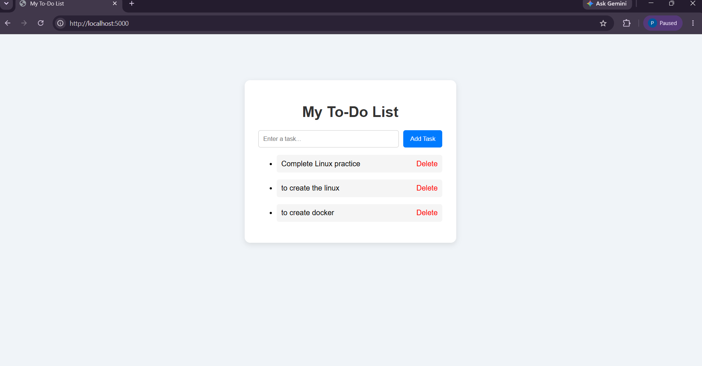

# 📝 Dockerized To-Do List Application

A simple and user-friendly To-Do List web application built using Python Flask, HTML, and CSS. The application is containerized using Docker for easy deployment and consistent execution.

## 🚀 Features

- Add new tasks
- View tasks
- Delete tasks
- Simple and user-friendly interface
- Runs inside a Docker container

## 🛠️ Technologies Used

- Python
- Flask
- HTML
- CSS
- Docker
- Linux (Ubuntu)
- Git
- GitHub

## 📁 Project Structure

```text
docker-todo-app/
├── static/
│   └── style.css
├── templates/
│   └── index.html
├── app.py
├── requirements.txt
├── Dockerfile
├── .dockerignore
├── README.md
└── todo-app-screenshot.png.png
```

## ⚙️ How to Run the Project

### Step 1: Clone the Repository

```bash
git clone https://github.com/Parinita2425/docker-todo-app.git
```

### Step 2: Open the Project Folder

```bash
cd docker-todo-app
```

### Step 3: Build the Docker Image

```bash
docker build -t todo-app .
```

### Step 4: Run the Docker Container

```bash
docker run -d -p 5000:5000 --name my-todo-container todo-app
```

### Step 5: Open the Application

Open your browser and visit:

http://localhost:5000

## 🛑 Stop the Container

```bash
docker stop my-todo-container
```

## 📸 Application Screenshot



## 👩‍💻 Author

**Parinita Ganesh Gurram**

GitHub: https://github.com/Parinita2425

---

⭐ If you find this project useful, feel free to explore the repository!